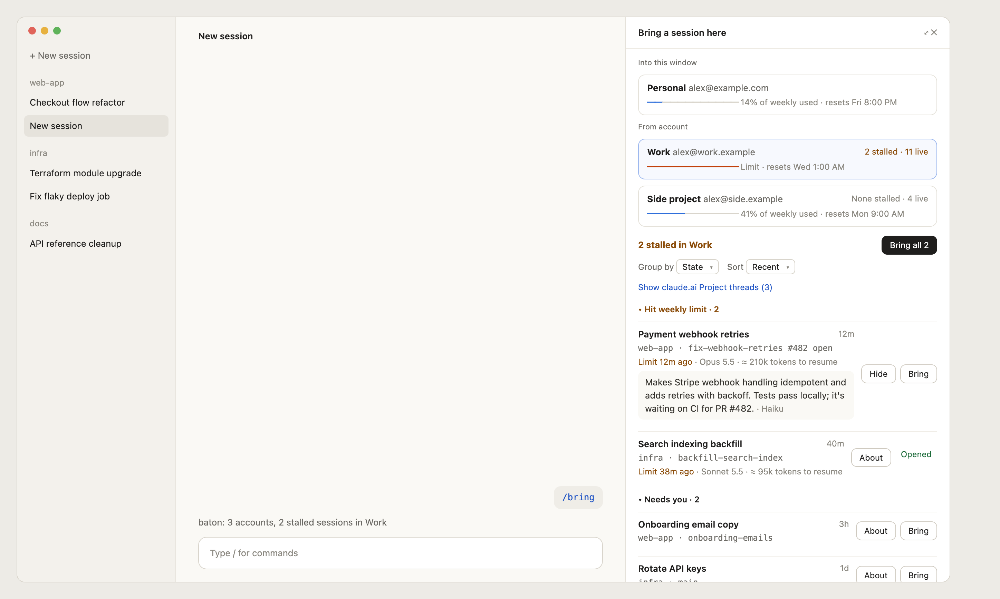
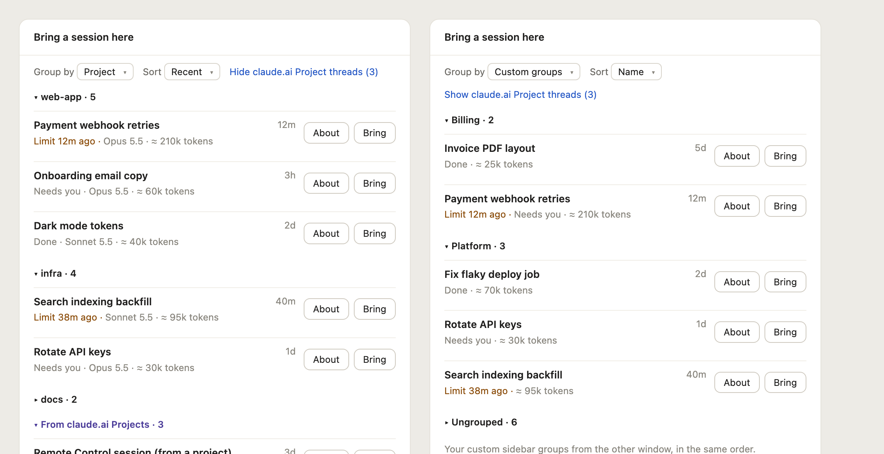
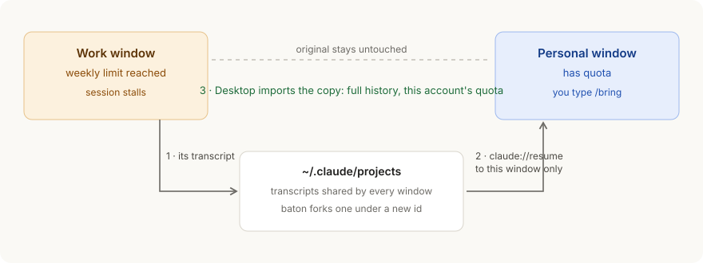

# baton

**Hit the weekly limit on one Claude account? Pick up the same session in another account's window, with its full history, in one click.**



## Why

If you have more than one Anthropic account (personal and work, or a spare for heavy weeks), running out of weekly quota on one of them stops every Code session it owns. The usual workaround is to open the other account's Claude Desktop window and ask Claude there to "find my session in the other account and carry on", which loses the real history and burns tokens on re-explaining.

baton turns that hand-off into a button. Its goals:

- **Continue, don't restart.** The session arrives with its whole conversation, tool results included, so the new account picks up exactly where the old one stopped.
- **Start from the window that has quota.** You open the other window, type `/bring`, and pull the session in. The window that ran out never needs to do anything (it can't).
- **Never touch the original.** baton copies; the stalled session stays in its own account, unchanged.
- **Scale past two accounts.** Every Desktop profile on the machine shows up, with its email and weekly usage, so you can spread work across several accounts.
- **Help you choose.** Stalled sessions come first, **About** gives a short summary of each one, and you can group the list the way Desktop's sidebar does.

## What it looks like

`/bring` opens a panel beside the conversation:

- **Into this window**: the account you're in and how much of its week is left.
- **From account**: every other account with its email, a weekly usage meter, and how many of its sessions are stalled.
- **Sessions** of the selected account, stalled first. **Bring** copies one here and opens it. **Bring all** takes every stalled one. **About** expands a 2-3 sentence summary (written by Haiku on this window's account), so similar titles are easy to tell apart.

Group and sort them like Desktop's sidebar: by **State** (hit limit, needs you, done), **Date**, **Project** (repo), your own **Custom groups** from the other window, or **None**. Sessions started from a claude.ai Project thread are hidden unless you ask for them, and never count as stalled.



## How it works



Every Claude Desktop window on a Mac keeps its own list of Code sessions, but the conversations themselves live in one shared folder, `~/.claude/projects`. So bringing a session takes three steps:

1. baton copies the session's transcript under a new id (streamed with `sed`, so even a 60 MB transcript takes about a second);
2. it sends `claude://resume?session=<new id>` to **this** window's Claude process, even when several windows are running;
3. Desktop's own import adopts the copy and opens it, with this account's connectors and quota.

The first message in the new account rebuilds the prompt cache once, so a long session costs more tokens on that turn.

## You need

- macOS and Claude Desktop with the Code tab.
- One Desktop window per account, each on its own profile. The default profile is `~/Library/Application Support/Claude`. Start another and sign in to the other account there:

  ```bash
  open -n -a Claude --args --user-data-dir="$HOME/Library/Application Support/Claude-Work"
  ```

  Any folder name starting with `Claude` works.

## Install

```bash
claude plugin marketplace add dreamiurg/baton
claude plugin install baton@baton --scope user
```

or, inside a terminal Claude Code session:

```
/plugin install baton --marketplace dreamiurg/baton
```

and pick the user scope. Every Desktop window loads it after a restart (or `/reload-plugins`). Update later with `claude plugin update baton`.

## Use

In the window that still has quota, open any Code session and type `/bring` (or `/bring work` to open a specific account). Pick a session, press **Bring**, and it opens in this window's sidebar.

## Optional: names and emails

baton labels each account by its profile folder. To show your own names and emails, create `~/.config/baton/config.json`:

```json
{
  "profiles": {
    "Claude": { "label": "Personal", "email": "me@example.com" },
    "Claude-Work": { "label": "Work", "email": "me@work.example" }
  }
}
```

## Good to know

- Bring makes a copy. Continuing in both windows makes two separate conversations.
- Weekly usage for an account appears once baton has run in that account's window.
- Sessions move between accounts on the same Mac. A session on another computer isn't visible here.
- Only Code-tab sessions. claude.ai chats and Cowork sessions aren't covered.

## Develop

```bash
npm install
git config core.hooksPath .githooks
scripts/lay-types.sh
npm run check
```

`npm run check` type-checks, runs the unit tests, validates the plugin and runs the mod tests. The README screenshots are rendered from `docs/demo/*.html` with headless Chrome and use made-up accounts and sessions.

MIT licensed.
