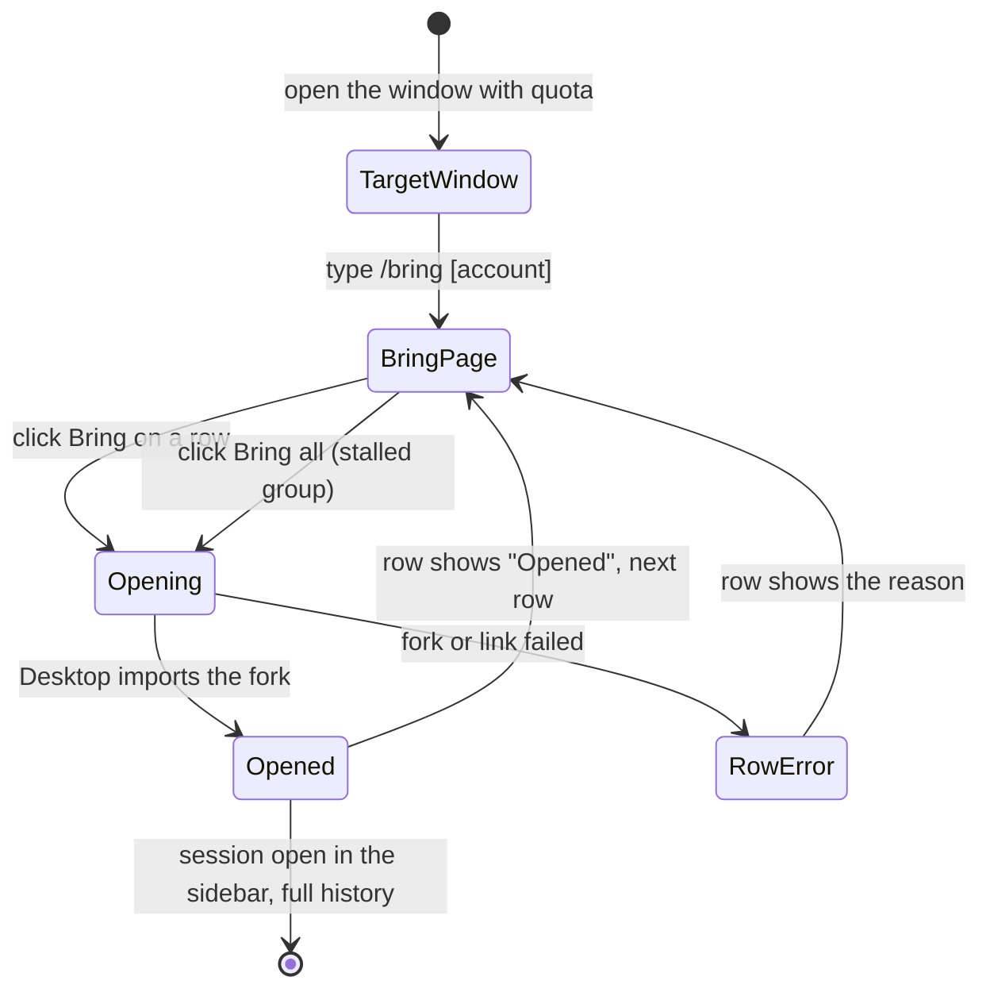

# baton: bring Claude Desktop sessions across accounts

Date: 2026-10-14. Status: design approved in chat, spec awaiting review.

## Goal

Dmytro runs one Claude Desktop window per Anthropic account (`Claude` profile = the@dreamiurg.net, `Claude-Call-E` profile = dmytro@call-e.io, more later for load balancing). When one account hits its weekly limit, he opens the other window and wants to continue the stalled Code-tab sessions there, with full history, in a couple of clicks.

Success: in the target window, type `/bring`, click Bring on a row (or Bring all), and the session opens in that window's sidebar with its full conversation, ready to continue on that account's quota. No restart, no copy-paste, no asking Claude to "move the session over".

Out of scope (v1): claude.ai chat conversations and Cowork sessions, archiving or editing the source session, a menu bar app, an automatic band, Windows/Linux.

## Verified facts this design rests on

All checked on this machine with Desktop 2.1.295 on 2026-10-14.

1. A Desktop Code session is a record at `<profile>/claude-code-sessions/<accountUuid>/<orgUuid>/local_<id>.json`. It points at a CLI transcript through `cliSessionId`.
2. Every profile's Code tab reads transcripts from the same `~/.claude/projects/<encoded-cwd>/<cliSessionId>.jsonl`. Moving a session never copies a transcript between profiles.
3. `claude://resume?session=<cliSessionId>` makes the receiving Desktop process run its own `importCliSession`: it creates the record under the signed-in account, fills title, cwd, model and connectors, and opens the session. No restart.
4. A JXA Apple Event (`GURL`) sent to a specific Desktop PID delivers that link to that process only.
5. A transcript written under Call-E resumed under Personal without error, thinking signatures included. The first turn rebuilds the prompt cache (about 145k tokens for a small session).
6. Deleting an adopted session in Desktop leaves the `.jsonl` on disk.
7. A mod loaded in a Desktop Code session can register `/bring`, answer it without a model turn, open a docked Pane (`placed=true`), and read another profile's records with `$.fs`.
8. A Code-tab CLI process runs from `<profile>/claude-code/<version>/…/claude`, and its ancestor `/Applications/Claude.app/Contents/MacOS/Claude` is that window's Desktop process. So the mod knows its own profile and its own Desktop PID without config.
9. A record that hit the limit carries `error: "You've hit your weekly limit · resets …"` and `errorAt`.

## User flow

Pages: the **Bring page** is the docked Pane titled "Bring a session here". One tab per other profile with its live-session count. Group 1 "Hit weekly limit" (with a Bring all button), group 2 "Other recent". Each row: title, folder and branch, age, and a Bring button. A filter field narrows by title or folder. The approved mockup is in the 2026-10-14 design session.

## Architecture

Two pieces in one repo. The CLI holds all logic so it can be tested and run from a terminal; the mod is a thin UI over it.

### `baton` CLI (Python 3, stdlib only, one file)

- `baton list --json [--from <profile>]`: every live (not archived) record in every other profile whose transcript exists, as JSON rows `{profile, label, sessionId, cliSessionId, title, cwd, branch, lastActivityAt, limited}`. "Other" means every `~/Library/Application Support/Claude*` dir that has `claude-code-sessions`, minus the caller's own profile.
- `baton bring <cliSessionId>...`: for each id, fork the transcript, then send `claude://resume?session=<fork>` to the caller's own Desktop PID. Prints one JSON result per id.
- Own profile and own Desktop PID come from fact 8 (walk the parent chain). `--profile` and `--pid` override for terminal use.
- Labels: `~/.config/baton/config.json` maps profile dir names to labels (`{"Claude": "Personal", "Claude-Call-E": "Call-E"}`). A missing entry falls back to the dir name with dashes as spaces, as Desktop itself labels sibling profiles.

Fork: copy `<cli>.jsonl` to `<new-uuid>.jsonl` in the same project dir, rewriting each line's `sessionId` from the old id to the new one and dropping `bridge-session` lines (Remote Control ids are account-bound). Copy the `<cli>/` sidecar dir (subagents, tool results) when present. Write to a temp name and rename, so Desktop never sees a half-written file.

Send: `osascript -l JavaScript` with the 10-line GURL script, targeted at the PID.

### `baton` mod (TypeScript hooks module)

- `session.start`: register `/bring` with an optional account argument.
- `command.run` for `bring`: run `baton list --json`, store rows in `$.state`, open the Pane, answer with one short line (no plugin prefix, the engine adds it).
- `ui.render` Pane: the Bring page as above, rows as normal (not `plain`) Buttons.
- Bring press: run `baton bring <id>`; the row goes Opening, then Opened or the error text. Bring all runs the stalled group one by one.

Install: the repo is a local plugin marketplace (`.claude-plugin/marketplace.json`). `claude plugin marketplace add ~/src/dreamiurg/baton` and `claude plugin install baton` at user scope, so every Desktop window loads it (they all read `~/.claude`). The CLI path is resolved relative to the plugin root.

## Error handling

- Transcript missing for a record: the row is not listed (nothing to bring).
- Fork fails (disk, permissions): the row shows the error; the partial temp file is removed; the source is never touched.
- Link send fails, or own Desktop PID not found: the row shows the reason; the fork stays so a retry reuses it.
- Bringing the same source twice creates two forks. v1 accepts that; the row says "Opened" after the first one in this panel.
- Desktop's own import errors surface in Desktop as they do today.

## Testing

- CLI: one `test_baton.py` with plain asserts against a temp fixture tree (two fake profiles, records, a transcript with `sessionId` and `bridge-session` lines): profile discovery minus own, limited-first ordering, archived and missing-transcript filtering, fork rewrites every `sessionId` and nothing else, sidecar copied.
- Mod: one `*.test.ts` via `claude plugin test`: `/bring` registers and renders rows from stubbed `$.process.run` output on `terminal` and `desktop`; a press calls `baton bring` with the right id.
- Manual end to end: bring a real Call-E session into the Personal window and send one message; then the reverse once Call-E has quota.

## Risks and open items

- **Out-of-quota window:** `/bring` runs in the window that has quota, so this does not matter for v1. Fact 7 also shows the command never calls the model.
- **Desktop internals change:** baton reads record fields and uses the public `claude://resume` link. It never writes Desktop's records. A schema change breaks listing, not data.
- **Cost:** each bring rebuilds the prompt cache on the first turn in the new account; long sessions cost more.
- **Concurrent use:** if the source session is still running in its window, the fork is a snapshot and the two diverge. Expected for "copy" semantics.
- **Source sidebar clutter:** stalled sessions stay in the source window. Archiving them is a later feature (it means writing live Desktop state).
