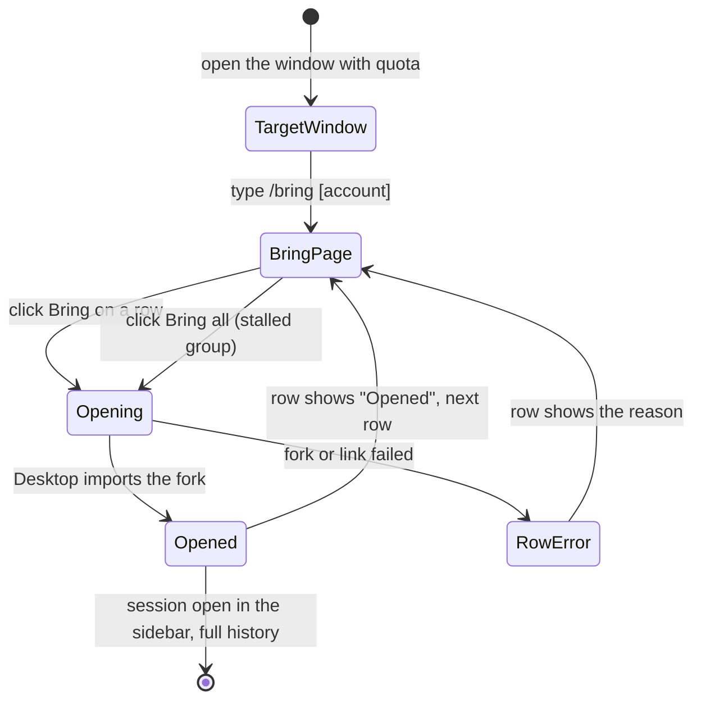

# baton: bring Claude Desktop sessions across accounts

Date: 2026-10-14. Status: design and visual design approved; spec awaiting review.

## Goal

The user runs one Claude Desktop window per Anthropic account, each on its own profile (for example the default `Claude` profile for a personal account and `Claude-Work` via `--user-data-dir` for a work account), and may add more accounts to balance load. When one account hits its weekly limit, he opens the other window and wants to continue the stalled Code-tab sessions there, with full history, in a couple of clicks.

Success: in the target window, type `/bring`, click Bring on a row (or Bring all), and the session opens in that window's sidebar with its full conversation, ready to continue on that account's quota. No restart, no copy-paste, no asking Claude to "move the session over".

Out of scope (v1): claude.ai chat conversations and Cowork sessions, archiving or editing the source session, a menu bar app, an automatic band, Windows/Linux.

## Verified facts this design rests on

All checked on this machine with Desktop 2.1.295 on 2026-10-14.

1. A Desktop Code session is a record at `<profile>/claude-code-sessions/<accountUuid>/<orgUuid>/local_<id>.json`. It points at a CLI transcript through `cliSessionId`.
2. Every profile's Code tab reads transcripts from the same `~/.claude/projects/<encoded-cwd>/<cliSessionId>.jsonl`. Moving a session never copies a transcript between profiles.
3. `claude://resume?session=<cliSessionId>` makes the receiving Desktop process run its own `importCliSession`: it creates the record under the signed-in account, fills title, cwd, model and connectors, and opens the session. No restart.
4. A JXA Apple Event (`GURL`) sent to a specific Desktop PID delivers that link to that process only.
5. A transcript written under one account resumed under another account without error, thinking signatures included. The first turn rebuilds the prompt cache (about 145k tokens for a small session).
6. Deleting an adopted session in Desktop leaves the `.jsonl` on disk.
7. A mod loaded in a Desktop Code session can register `/bring`, answer it without a model turn, open a docked Pane (`placed=true`), and read another profile's records with `$.fs`.
8. A Code-tab CLI process runs from `<profile>/claude-code/<version>/…/claude`, and its ancestor `/Applications/Claude.app/Contents/MacOS/Claude` is that window's Desktop process. So the mod knows its own profile and its own Desktop PID without config.
9. A record that hit the limit carries `error: "You've hit your weekly limit · resets …"` and `errorAt`.

## User flow

## The Bring page

The approved visual design: [Baton: Bring a session](https://claude.ai/artifact/Uyz8y4NND7SVdFCJ8P1Smw) (two artboards: the page in context, and its states; the link is private to the author). The **Bring page** is the docked Pane titled "Bring a session here", top to bottom:

1. **Into this window**: one card for the window's own account: initials badge, label, email, weekly usage bar with "N% of weekly used · resets <day time>".
2. **From account**: one selectable card per other profile, scaling to any number of accounts: initials badge (amber when that account is at its limit), label, email, weekly usage bar with reset time or "Limit · resets …", and on the right "N stalled" (amber) or "None stalled", and "N live". The first card with stalled sessions is selected on open; `/bring <label>` selects that one.
3. **Filter** field: narrows rows by title, folder or branch.
4. **Hit weekly limit · N** group, shown only when N > 0, with a **Bring all N** button (the one primary button on the page). Rows sorted by most recent limit first.
5. **Other recent · N** group: the account's other live sessions, most recent first.
6. Footer: "Bring makes a copy here. The original stays in <label>."

A stalled row has three lines: title and age; `folder · branch` plus a PR chip (`#41 open`) when the record has one; chips for "Limit <ago>", the model, and "≈ Nk tokens to resume". A recent row has the first two lines only. The right side of every row is one action slot:

| Row state | Slot shows | Next |
|---|---|---|
| Idle | **Bring** button | press → Opening |
| Queued (Bring all) | "Queued" | its turn → Opening |
| Opening | "Opening…" | import done → Opened; failure → Failed |
| Opened | "Opened" (green) | final for this panel |
| Failed | **Retry** button, reason in red under the row | press → Opening, reusing the fork |

While Bring all runs, its button reads "Bringing 2 of 4…"; after, "All brought". Page-level states: **nothing stalled** (a gray note "No session in <label> has hit its limit. You can still bring any recent one." and only the Recent group) and **empty account** ("No live sessions in <label>.").

Data behind each element:

- Label and email: `~/.config/baton/config.json`, `{"profiles": {"Claude": {"label": "Personal", "email": "me@example.com"}, ...}}`. Desktop keeps no plain-text email. A profile missing from the config shows its dir name and no email.
- Usage: each window's baton mod writes its own account's latest `rateLimits` (`seven_day` `percentUsed` and `resetsAt`, from the `session.measure` event) to `~/.local/state/baton/usage/<profile>.json` with a timestamp. The page reads every profile's file. Fallbacks in order: the newest `sd` sample for that org in `<profile>/plan-usage-history.json` (no reset time), then the reset text from the newest limit error in that profile's records, then no bar. A reading older than 6 hours shows "as of <age>".
- Stalled: record `error` matches the weekly-limit text; "Limit <ago>" from `errorAt`.
- PR chip: the record's `prs` (last entry) or `prNumber`/`prState`.
- Model: record `model`, shown by family and version.
- Tokens to resume: transcript bytes ÷ 4, rounded, labeled approximate.

**Deviation from the mockup:** the mockup tags brought sessions "from Personal" in Desktop's left sidebar. A mod cannot draw in Desktop's sidebar, so v1 has no tag there; the Bring page's "Opened" state is the confirmation. (Renaming the fork's title to carry the tag is possible but changes the session's title for good; left out unless asked.)

## Architecture

One TypeScript mod, no separate CLI. The earlier CLI existed for terminal and launcher wrappers that are now out of scope, and a Python dependency is friction for friends installing the mod. Everything the CLI did, the mod does with `$.fs` (read, write, list) and `$.process.run` (`ps`, `cp`, `mv`, `osascript`).

### Modules

- `hooks/register.tsx`: hooks and the Bring page drawing only. It calls the pure modules below and owns `$.state`.
- `lib/profiles.ts` (pure): find profiles (every `~/Library/Application Support/Claude*` dir with `claude-code-sessions`), parse records into rows `{cliSessionId, title, cwd, branch, lastActivityAt, limitedAt, pr, model, tokensApprox}` (live, not archived, transcript exists), group stalled vs recent, sort, apply the label/email config, pick the usage reading per the fallback order above.
- `lib/fork.ts` (pure): given transcript text and a new id, return the rewritten text: each line's `sessionId` from the old id to the new one, `bridge-session` lines dropped, every other byte unchanged.
- `lib/self.ts`: own profile and own Desktop PID from the process chain (fact 8): `/bin/sh -c 'echo $PPID'` gives the Claude Code process, then `ps -o ppid=,command=` walks up to `/Applications/Claude.app/Contents/MacOS/Claude`; the Claude Code binary's path names the profile.
- Pure modules take their inputs as arguments (no `$`), so plain tests cover them. If the engine refuses relative imports from the hooks module, everything moves into `register.tsx` with the same function boundaries.

### Bring, step by step

1. Read `<cli>.jsonl`, fork it with `lib/fork.ts`, write `<new-uuid>.jsonl.tmp` in the same project dir, `mv` it into place (Desktop never sees a half-written file). Copy the `<cli>/` sidecar dir (subagents, tool results) with `cp -R` when present.
2. Send `claude://resume?session=<new-uuid>` to the own Desktop PID: `osascript -l JavaScript -e <GURL script> <pid> <url>`.
3. Desktop imports and opens it (fact 3). The mod marks the row Opened when the new record `local_<new-uuid>.json` appears in the own profile (poll briefly), else Failed with "Desktop didn't open it".

### Hooks

- `session.start`: register `/bring` with an optional account label argument.
- `session.measure`: when the `seven_day` window moved, write this profile's reading to `~/.local/state/baton/usage/<profile>.json`.
- `command.run` for `bring`: build the page model, store it in `$.state`, open the Pane, answer with one short line such as "2 accounts, 4 stalled sessions in Personal" (no plugin prefix; the engine adds it).
- `ui.render` Pane: the Bring page, drawn with the desktop surface's `Box`, `Text`, `Button` and `Input`; row buttons are normal (not `plain`) Buttons. Layout and content follow the mockup; exact colors and spacing follow what those elements allow.
- Bring press: run the steps above; Bring all queues the stalled group and runs it one at a time.

## Repository, sharing and quality gates

Public GitHub repo `dreamiurg/baton`, so friends can install it. The repo is its own plugin marketplace:

- The repo root is the plugin: `.claude-plugin/plugin.json` and `.claude-plugin/marketplace.json` side by side, the marketplace's one entry with `"source": "./"`.
- README: what it does (with a screenshot of the Bring page), the prerequisite (two or more Desktop windows on separate profiles via `--user-data-dir`, with a short how-to), install (`/plugin install baton --marketplace dreamiurg/baton`, typed in a terminal Claude Code session, user scope), the optional config file, and limits (macOS only, Code-tab sessions only, a bring costs one cache rebuild).
- Works for friends with zero config: labels fall back to profile dir names; emails are optional.
- No personal paths, emails or ids in the code; the mockup data stays in the design artifact only.

Quality gates, taken from the bootstrap-quality checklist and cut to what this repo needs:

- Pre-commit hook (lefthook or a plain `.githooks/pre-commit`, whichever is lighter): `tsc --noEmit`, unit tests, `claude plugin validate`.
- GitHub Actions CI on PRs and main: same three checks on macOS, Node LTS. One required check.
- Branch protection on `main`: PRs only, the CI check required, no force pushes.
- Dependabot for GitHub Actions only (the mod has no npm runtime dependencies).
- Versioning: bump `version` in `plugin.json` per release by hand, with a git tag; friends get it with `claude plugin update`. No release automation yet.

Skipped on purpose: coverage thresholds, complexity analysis, semantic-release, supply-chain scanning beyond Dependabot. Add when the repo grows past one mod.

## Error handling

- Transcript missing for a record: the row is not listed (nothing to bring).
- Fork fails (disk, permissions): the row goes Failed with the reason; the temp file is removed; the source is never touched.
- Own Desktop PID not found, or the link send fails: Failed with the reason; the fork stays so Retry reuses it.
- Desktop doesn't create the record within the wait: Failed, "Desktop didn't open it"; Retry resends the link.
- Bringing the same source twice creates two forks. v1 accepts that; within one panel the row stays Opened.

## Testing

- Unit (`node --test` on the pure modules, with type stripping): profile discovery from a temp fixture tree (two fake profiles, archived and missing-transcript records filtered, stalled vs recent split and order), config fallbacks, usage fallback order, fork rewrites every `sessionId` line and nothing else and drops `bridge-session` lines, process-chain parsing from captured `ps` output.
- Mod (`claude plugin test`): `/bring` registers; the Pane renders the page model on `terminal` and `desktop`; a Bring press drives Idle → Opening → Opened with stubbed `$.process.run`.
- Manual end to end, before each release: bring a real session between two profiles and send one message.

## Risks and open items

- **Out-of-quota window:** `/bring` runs in the window that has quota, so this does not matter for v1. Fact 7 also shows the command never calls the model.
- **Desktop internals change:** baton reads record fields and uses the public `claude://resume` link. It never writes Desktop's records. A schema change breaks listing, not data.
- **Cost:** each bring rebuilds the prompt cache on the first turn in the new account; long sessions cost more.
- **Concurrent use:** if the source session is still running in its window, the fork is a snapshot and the two diverge. Expected for "copy" semantics.
- **Source sidebar clutter:** stalled sessions stay in the source window. Archiving them is a later feature (it means writing live Desktop state).
